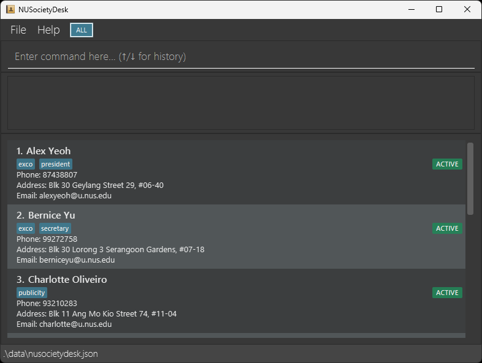

# NUSocietyDesk

NUSocietyDesk is an offline desktop member directory for NUS society secretaries. It combines typed commands with a graphical list so a secretary can import an existing directory, find a member, update their details, and retain former members without deleting their records.

The screenshot is an early UI concept that shows a `FORMER` badge. The current app displays `ARCHIVED` for archived members; new members start `ACTIVE`.

## Current MVP

| Task | Command | Current behavior |
| --- | --- | --- |
| Bring in an existing directory | `import "members.csv"` | Imports valid records from a UTF-8 CSV and reports each rejected record. |
| Add a member | `add e/alex@u.nus.edu n/Alex Tan t/Publicity` | Requires a unique NUS email; name, phone, address, and tags are optional. |
| Complete or correct details | `edit 2 p/91234567` | Changes supplied contact fields while retaining the others. |
| Maintain roles and committees | `tag 2 t/President`, `untag 2 t/President` | Adds or removes one tag at a time. |
| Find members | `find e/alex`, `findall n/Alex t/publicity`, `findany n/Alex e/alex` | Searches one field, or combines conditions with AND or OR. |
| Choose a status view | `view active`, `view archived`, `view all` | Changes the button and displayed list without clearing the current search. |
| View the selected status | `list` | Clears a search while keeping the All, Active, or Archived view selected in the GUI. |
| Retain former members | `archive 2`, `activate 2` | Changes status without deleting contact details; choose All or Archived to view former members. |
| Remove a record | `delete 2` | Permanently deletes the member at the displayed index. |

The GUI opens in All view. Each click of the status button cycles **All → Active → Archived → All**; `view STATUS` selects the same view from the command box. Searches apply to the selected view, and changing the view keeps the current search. `list` clears the search without changing the view. `edit`, `tag`, `untag`, `archive`, `activate`, and `delete` use the index in the currently displayed list, including filtered results. A successful data change is saved to `data/nusocietydesk.json` beside the JAR, with `preferences.json` in the same directory; the data file is loaded on startup. The app also provides command history with the ↑ and ↓ keys and reports invalid commands and save failures.

The current identity rule is a unique `@u.nus.edu` email. Names and phone numbers may be shared, and a phone-only or personal-email contact cannot currently be added or imported. Name searches match whole words and tag searches match complete tags; phone and email searches accept substrings.

See the [User Guide](docs/UserGuide.md) for the CSV format, command syntax, and data recovery behavior. The [Developer Guide](docs/DeveloperGuide.md) describes the target user, user stories, and design.

## Scope and next steps

The core member-management workflows above are implemented. The project is still under development. Potential later additions include phone-only records, international phone formats, sorting, undo, and duplicate review; these are outside the current MVP.

## Acknowledgements

NUSocietyDesk builds on AddressBook Level 3 (AB3) as part of the CS2103T team project.
